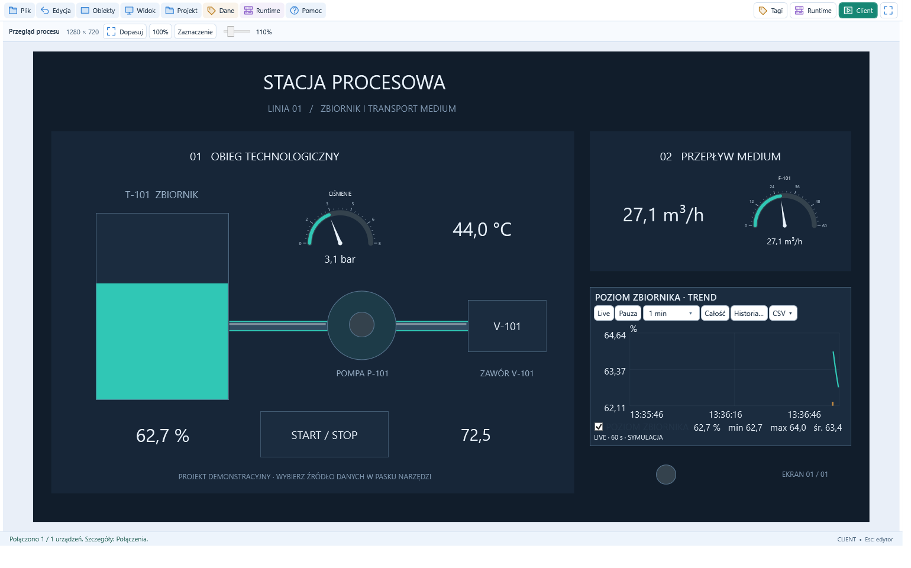
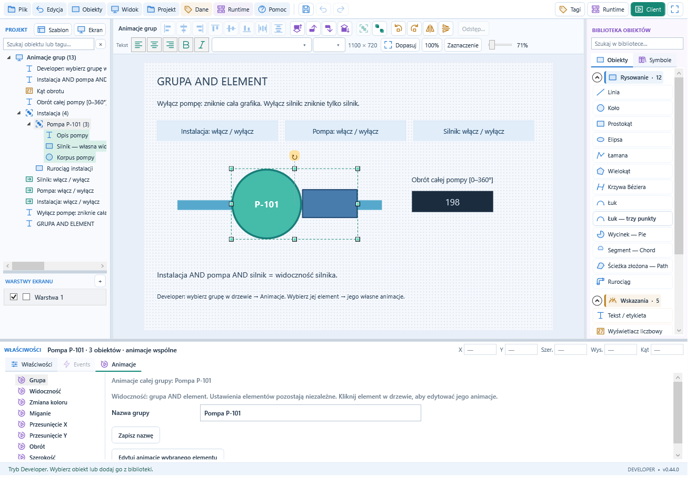
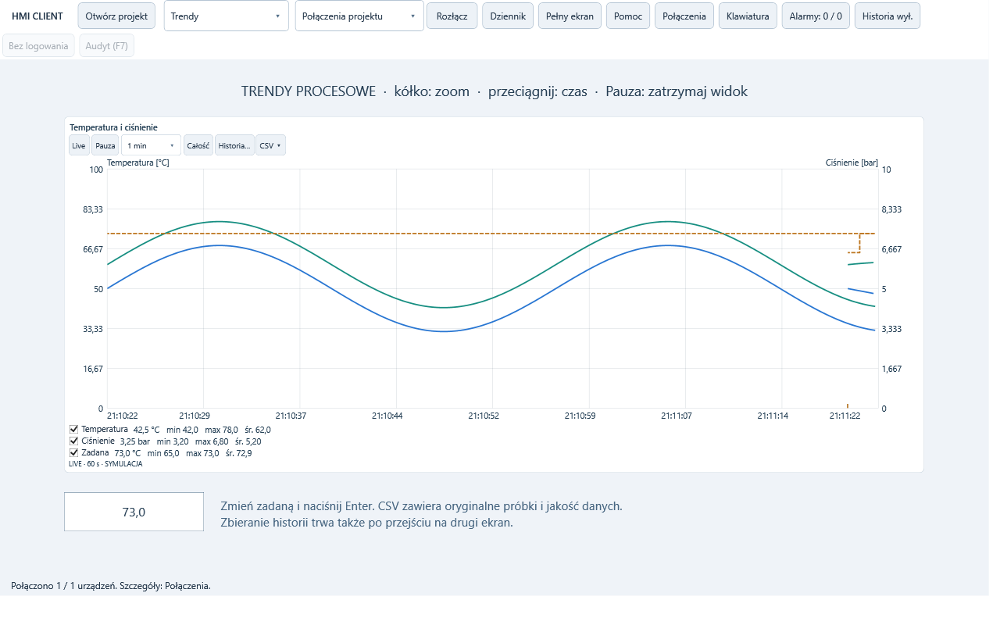
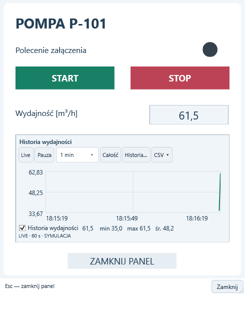

# HMI Studio

Darmowy program dla Windows x64 do projektowania wizualizacji i obsługi urządzeń przemysłowych.

**[Pobierz instalator 0.44.0 Beta](https://github.com/marcin7d/HMI-Studio/releases/tag/v0.44.0-beta)** — plik `HmiStation-0.44.0-win-x64.exe` znajduje się w sekcji Assets wydania, razem z sumą kontrolną SHA-256.

**[Przeglądaj pełną instrukcję online](https://marcin7d.github.io/HMI-Studio/)** — 75 rozdziałów z wyszukiwaniem, grafikami i przykładami do pobrania. Dostępna w przeglądarce bez instalowania programu.

## Przykładowe ekrany

Zrzuty pokazują projekty demonstracyjne i dane symulowane. [Otwórz pełną galerię](screenshots/README.md).

### Stacja procesowa — podgląd projektu

Zbiornik, pompa, zawór, wskaźniki ciśnienia i przepływu oraz trend poziomu.

### Developer — animacje grup

Drzewo obiektów, biblioteka geometrii i właściwości wspólnej animacji grupy.

### Client — trendy procesowe

Temperatura, ciśnienie, wartość zadana, statystyki i sterowanie widokiem trendu.

### Panel sterowania pompą

Popup z przyciskami START / STOP, nastawą wydajności i trendem.

## Trzy programy

- **Developer** — projektowanie ekranów i symboli, parametryzowanie obiektów, animacje, zdarzenia oraz skrypty Python.
- **Runtime** — przechowywanie projektu, komunikacja ze sterownikami, zbieranie danych, alarmy i archiwizacja. Pracuje jako usługa Windows niezależnie od otwartych okien.
- **Client** — sesja operatorska wyświetlająca projekt, umożliwiająca sterowanie oraz przegląd alarmów, trendów i historii.

Komunikacja: **OPC UA, Siemens S7 Plus i Modbus TCP**. Developer łączy się z Runtime po sieci; pierwsze parowanie zatwierdza się na stanowisku Runtime.

## Warianty instalacji

| Wariant | Instalowane składniki |
| --- | --- |
| Stanowisko | Client, Runtime i PostgreSQL / TimescaleDB z automatyczną konfiguracją |
| Tylko Client | Client do istniejącego Runtime |
| Tylko Developer | Developer, pomoc offline i przykłady |
| Wszystko | Developer, Client, Runtime i baza danych |

Instalacja wymaga uprawnień administratora. Wymagane środowiska są dołączone do instalatora. Szczegółowa instrukcja jest dostępna [online](https://marcin7d.github.io/HMI-Studio/) oraz offline w programie.

## Wersja testowa

Program jest rozwijany jako **beta**. Aktualne wydanie obsługuje jedną aktywną sesję Client na Runtime. Instalator nie jest podpisany cyfrowo. Pełna instalacja tego wydania na czystym Windows, wielodniowe testy obciążenia i komunikacja S7 Plus z docelowym fizycznym CPU wymagają dalszej weryfikacji. Przed zastosowaniem na rzeczywistej instalacji należy sprawdzić działanie komunikacji, sterowania, alarmów, archiwizacji i odtwarzania kopii.

Repozytorium służy do udostępniania instalatorów i informacji o wydaniach. Kod HMI Studio ma licencję MIT; dołączone komponenty mają własne licencje dostarczane z programem.
